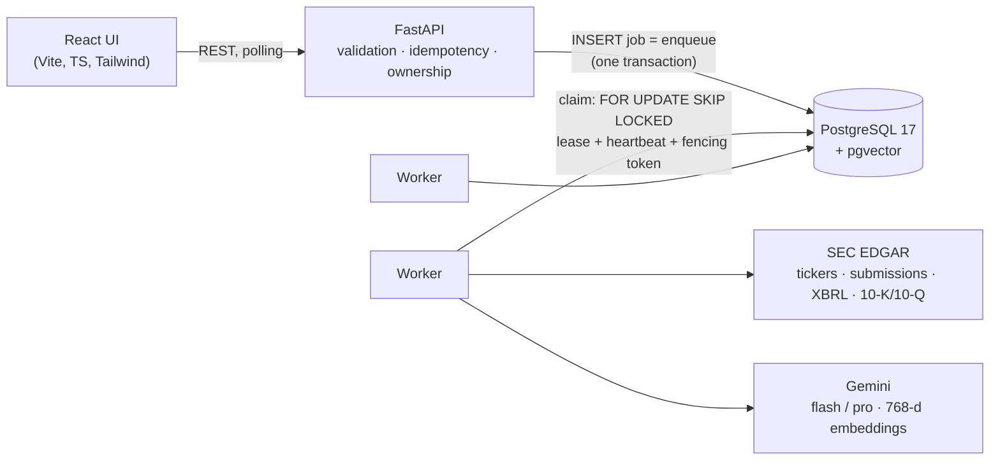

# FinResearch AI

Evidence-backed research on US-listed companies. Ask a question about a ticker; FinResearch reads the company's
SEC filings, computes its financials with tested formulas, drafts claims, checks every claim against its source,
and writes a report in which any statement opens to the passage, figure or formula behind it.

It's decision support, not a stock picker: unsupported claims are flagged, limitations are listed, and nothing
recommends buying or selling.

## What makes it trustworthy

- **Facts, calculations and interpretations are kept apart.** Facts must quote the filing verbatim; calculations
  come from code (`Decimal`, unit-tested formulas) and show their inputs; interpretations are labelled as opinion.
- **The model never does arithmetic.** It cites metric ids; the verifier checks every number in a claim against
  the computed metric.
- **Every quote is checked literally** against the stored filing text before a fact-checking model judges the rest.
- **Every reported figure carries provenance**: XBRL concept, filing accession, filed date and period.
- **Failures are visible.** Missing data, skipped metrics and unsupported claims appear in the report.

## Architecture



A job runs eight checkpointed stages; each writes its outputs idempotently, and a retry resumes after the last
completed stage.

| Stage | Kind | Output |
| --- | --- | --- |
| Resolve company | deterministic | SEC CIK, industry (financial-sector companies are rejected in v1) |
| Fetch filings | deterministic | latest 10-K and any newer 10-Q |
| Extract financials | deterministic | five fiscal years from XBRL, latest filing wins on restatement |
| Compute metrics | deterministic | margins, FCF, growth, ROE, leverage, CAGR, each with formula and inputs |
| Index filings | deterministic + embeddings | section-aware chunks, `tsvector` + HNSW `vector(768)` |
| Analyze | LLM | sub-questions, hybrid retrieval (RRF), drafted claims with quotes and metric refs |
| Verify | code first, then LLM | quote check, numeric check, fact-check verdicts |
| Synthesize | LLM | answer, summary, bull/base/bear with anchored assumptions, risks, limitations |

Design decisions, alternatives and failure modes are written up as ADRs in [`docs/adr/`](docs/adr):
[durable queue on Postgres](docs/adr/0001-postgres-backed-job-queue.md) ·
[job state machine](docs/adr/0002-job-state-machine.md) ·
[202 + idempotency keys](docs/adr/0003-submission-contract-and-idempotency.md) ·
[enum storage](docs/adr/0004-enum-storage.md) ·
[evidence and provenance model](docs/adr/0005-evidence-and-provenance-model.md) ·
[pipeline, retrieval and LLM use](docs/adr/0006-research-pipeline-retrieval-and-llm.md).

## Run it locally

Requirements: Python 3.12, Node 22+, Docker.

```bash
# 1. Database
docker compose up -d                                   # Postgres 17 + pgvector

# 2. Backend
python3.12 -m venv .venv && source .venv/bin/activate
pip install -r requirements.txt && pip install -e .
cp .env.example .env                                   # then fill in the values below
alembic upgrade head
uvicorn backend.main:app --reload                      # API on :8000, docs at /docs

# 3. Worker (one or more, in other terminals)
python -m backend.worker.main

# 4. Frontend
cd frontend && npm install && npm run dev              # UI on :5173
```

`.env`:

```bash
DATABASE_URL=postgresql+psycopg://finresearch:<password>@localhost:5432/finresearch
GEMINI_API_KEY=<free key from https://aistudio.google.com/apikey>
SEC_USER_AGENT=FinResearch AI <your contact email>       # SEC EDGAR requires a contact address
# PIPELINE=stub                                          # run the queue with fake stages, no external calls
```

## Tests

```bash
docker exec finresearch-postgres psql -U finresearch -c "CREATE DATABASE finresearch_test"   # once
python -m pytest                       # isolated *_test database, truncated after every test
cd frontend && npm run typecheck && npm run api:check
```

The suite covers the queue's concurrency guarantees (ten threads racing for one job, zombie-worker fencing, a real
`kill -9` of a worker process mid-job, graceful SIGTERM), the API contract, schema constraints, every metric formula,
XBRL extraction, filing parsing, and the full pipeline end to end with a fake SEC transport and a fake LLM.

## Evaluation

```bash
python -m backend.evals.citations auto <job_id>            # coverage, quote verification, numeric consistency
python -m backend.evals.citations export <job_id> > evals/labels/MSFT.json
python -m backend.evals.citations score evals/labels/*.json # human-labelled citation correctness vs the 95% target
```

## Project layout

```text
backend/
  api/            routes, dependencies (dev identity until auth lands)
  services/       transactions live here: job submission, queue operations, reports
  repositories/   SQL, including the fenced queue updates (never commit)
  pipeline/       stage runner, research stages, prompts and output schemas
  sources/        SEC EDGAR client, XBRL extraction, filing text parsing
  analysis/       metrics (Decimal), chunking, hybrid retrieval, verification
  llm/            provider adapter (Gemini) with retry classification
  worker/         the worker process: claim, heartbeat, retry, release
  evals/          evidence-quality metrics and label scoring
database/migrations/   Alembic revisions (never edit an applied one)
frontend/              React app; design system in frontend/DESIGN.md
docs/                  STATUS.md, ADRs, INTERVIEW_NOTES.md
```

## Scope (v1)

US-listed, non-financial companies that file a 10-K, in USD. No market price data, so no valuation multiples or
price targets. Single development user until authentication (planned with deployment).
