# FinResearch AI

[](https://github.com/asequas/finresearch-ai/actions/workflows/ci.yml)

Evidence-backed research on US-listed companies, done by a team of agents. Ask a question about a ticker: a planner
splits it into sub-questions, researcher agents search the company's SEC filings and code-computed financials in
parallel, a fact-checker verifies every claim and sends material failures back for another look, and the report
lets any statement open to the passage, figure or formula behind it. Then ask the analyst follow-up questions; its
citations are checked too.

It's decision support, not a stock picker: unsupported claims are flagged, limitations are listed, and nothing
recommends buying or selling.

## Tour

Real research on Amazon, Microsoft and NVIDIA filings, run end to end through the app.

| | |
| --- | --- |
| 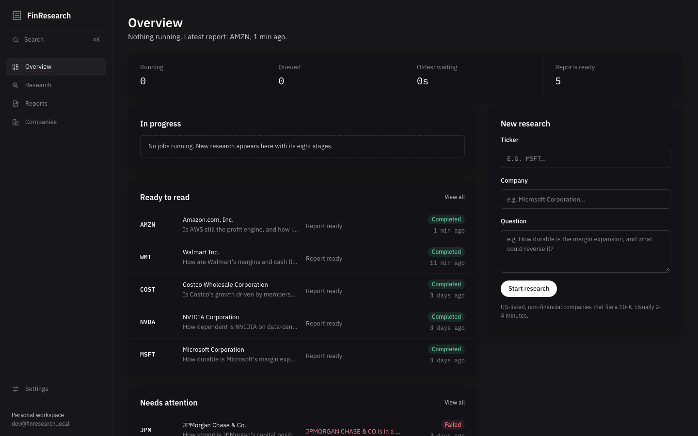 | 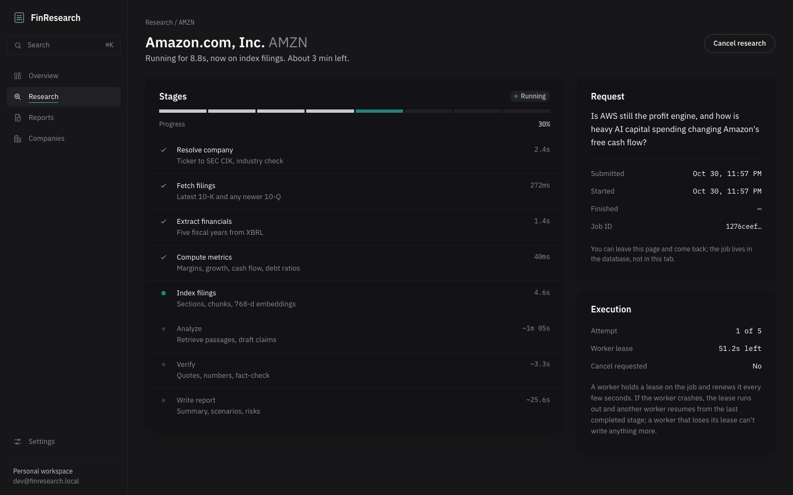 |
| **Overview.** What's running and what's ready; ⌘K searches every company, report and job. | **Live job.** Ten checkpointed stages with typical durations; leave and come back any time. |
| 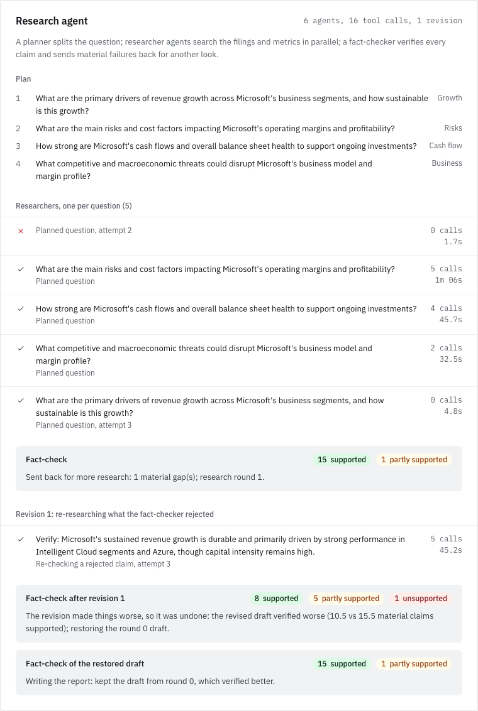 | 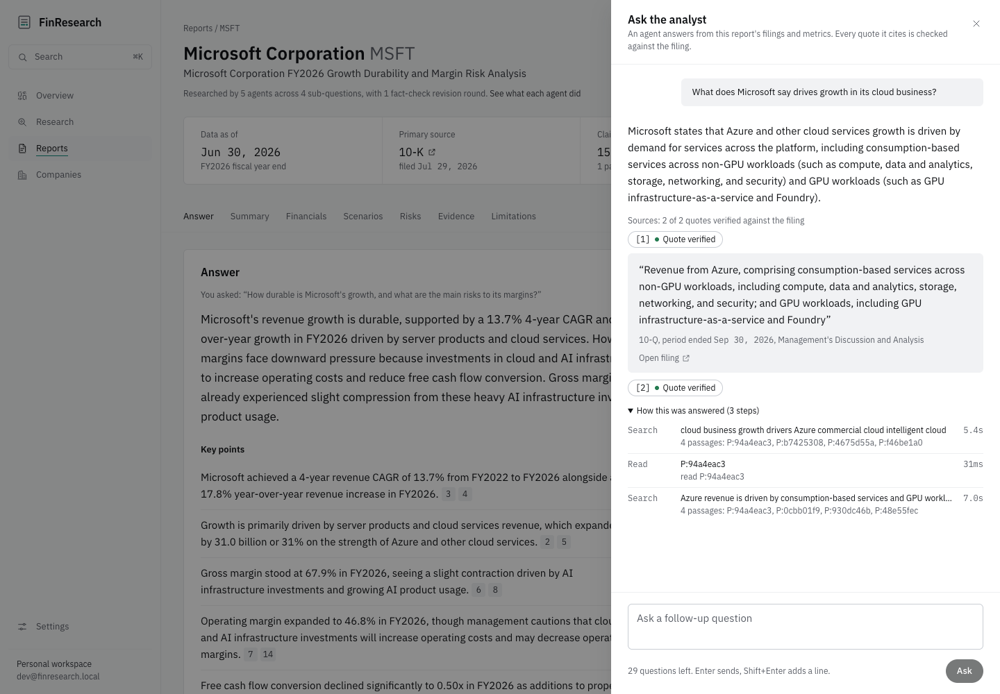 |
| **Research agent.** The plan, every researcher's tool calls, and the fact-checker's decisions. Here it sent a failed claim and an empty-handed question back for another round, and all 16 claims ended up supported. | **Ask the analyst.** Follow-up questions answered by a tool-using agent; each cited quote is checked against the filing. |
| 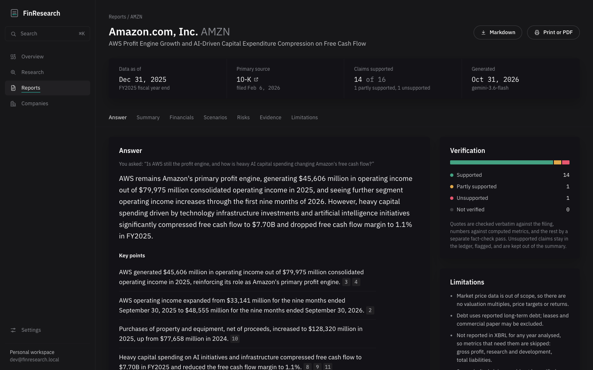 | 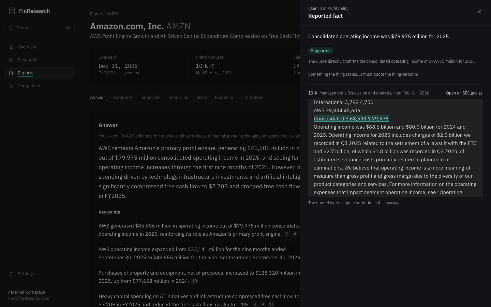 |
| **Report.** The answer first, then summary, financials, scenarios, risks and the evidence ledger. | **Claim inspector.** Every claim opens to the filing passage with the quoted words highlighted. |
| 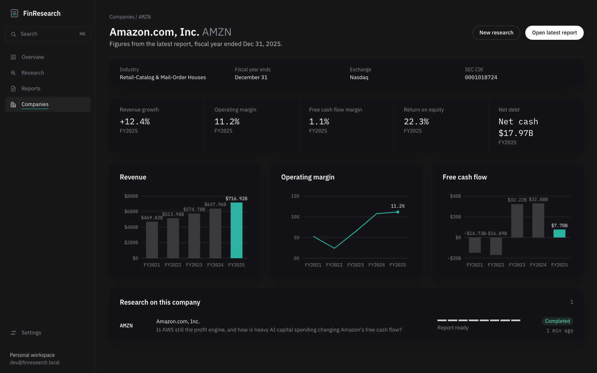 | 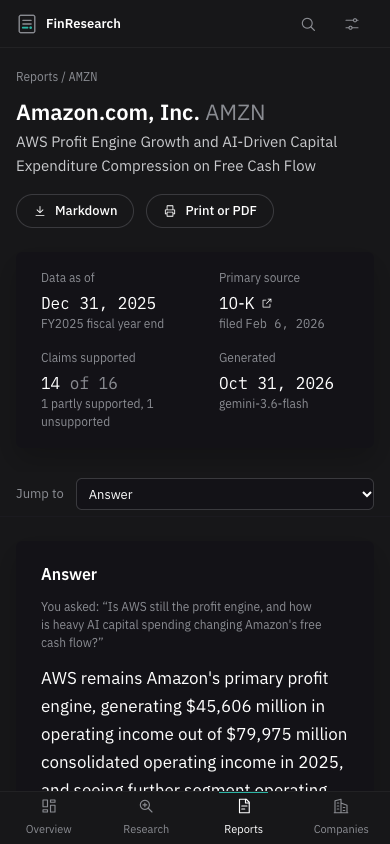 |
| **Company workspace.** Five years of reported figures and every report on the company. | **Phone.** The same report, laid out for a small screen. |
| 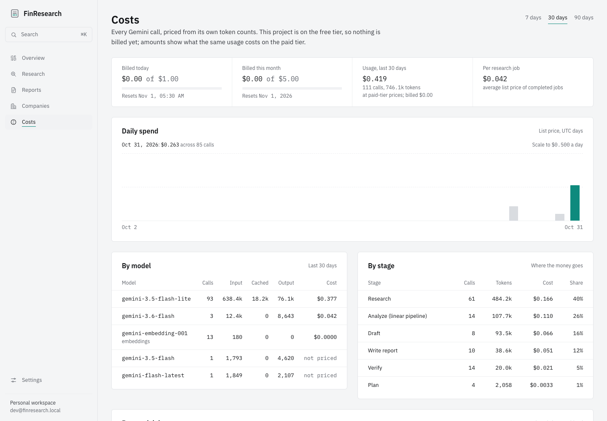 | 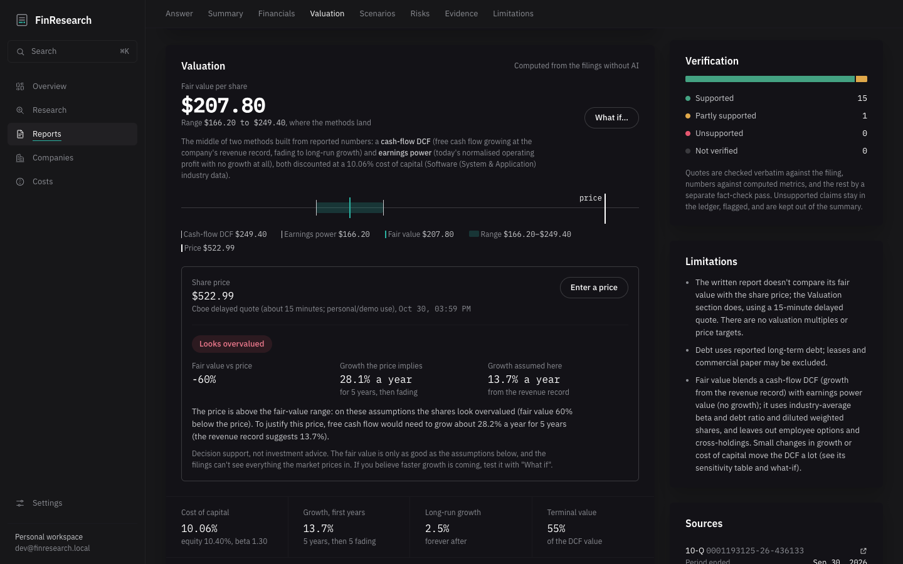 |
| **Costs.** Every model call priced from its token counts, against daily and monthly caps; by day, model, stage and job. | **Valuation.** A deterministic DCF with every assumption sourced, the projection, sensitivity grid and a what-if. |

## What makes it trustworthy

- **Facts, calculations and interpretations are kept apart.** Facts must quote the filing verbatim; calculations
  come from code (`Decimal`, unit-tested formulas) and show their inputs; interpretations are labelled as opinion.
- **The model never does arithmetic.** It cites metric ids; the verifier checks every number in a claim against
  the computed metric.
- **Every quote is checked literally** against the stored filing text before a fact-checking model judges the rest.
- **Every reported figure carries provenance**: XBRL concept, filing accession, filed date and period.
- **Failures are visible.** Missing data, skipped metrics and unsupported claims appear in the report.
- **Intrinsic value is computed, not generated.** A deterministic DCF (Damodaran's FCFF model, tested against his
  own worked example) values each company from its filings, with every assumption sourced and dated, a sensitivity
  range and a what-if panel. The report may quote it; the verifier checks the numbers.
- **Spend is measured and capped.** Every model call is a priced row in a cost ledger (input, cached, output and
  thinking tokens at Google's dated list prices); daily and monthly caps stop new work, and the Costs tab shows
  where the money goes. A research job costs about $0.04–0.11 at paid-tier prices.

## Architecture


Ingestion is deterministic code; the research itself is a LangGraph agent graph (ADR 0008), checkpointed in Postgres
so a retried job resumes at the node that failed:

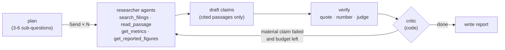

Each stage writes its outputs idempotently, every node is lease-fenced, and the job page shows each researcher's
tool calls live.

| Stage | Kind | Output |
| --- | --- | --- |
| Resolve company | deterministic | SEC CIK, industry (financial-sector companies are rejected in v1) |
| Fetch filings | deterministic | latest 10-K and any newer 10-Q |
| Extract financials | deterministic | five fiscal years from XBRL, latest filing wins on restatement |
| Compute metrics | deterministic | margins, FCF, growth, ROE, leverage, CAGR, each with formula and inputs |
| Value (DCF) | deterministic | FCFF DCF: industry beta, Treasury 10-year, Damodaran ERP; value per share, range, sensitivity |
| Index filings | deterministic + embeddings | section-aware chunks, `tsvector` + HNSW `vector(768)` |
| Plan | LLM | 3-6 sub-questions, each with a focus |
| Research | parallel tool-using agents | each researcher searches (tuned hybrid + local cross-encoder rerank), reads passages and pulls metrics, within a call budget |
| Draft | LLM | claims citing only passages the researchers read, plus verifier feedback on a revision |
| Verify | code first, then LLM; code-routed revision | quote check, numeric check, fact-check verdicts; material failures go back to a researcher once |
| Synthesize | LLM | answer, summary, bull/base/bear with anchored assumptions, risks, limitations |

Design decisions, alternatives and failure modes are written up as ADRs in [`docs/adr/`](docs/adr):
[durable queue on Postgres](docs/adr/0001-postgres-backed-job-queue.md) ·
[job state machine](docs/adr/0002-job-state-machine.md) ·
[202 + idempotency keys](docs/adr/0003-submission-contract-and-idempotency.md) ·
[enum storage](docs/adr/0004-enum-storage.md) ·
[evidence and provenance model](docs/adr/0005-evidence-and-provenance-model.md) ·
[pipeline, retrieval and LLM use](docs/adr/0006-research-pipeline-retrieval-and-llm.md) ·
[retrieval tuning and reranking](docs/adr/0007-retrieval-tuning-and-reranking.md) ·
[LangGraph research agent](docs/adr/0008-langgraph-research-agent.md) ·
[LLM cost controls and ledger](docs/adr/0009-llm-cost-controls-and-ledger.md) ·
[DCF intrinsic value](docs/adr/0010-dcf-intrinsic-value.md).

Retrieval quality on a 30-question gold set over real filings (ADR 0007):

| | Recall@1 | Recall@3 | MRR@10 | nDCG@6 |
| --- | --- | --- | --- | --- |
| Hybrid search as first built | 0.567 | 0.800 | 0.706 | 0.528 |
| Tuned hybrid + cross-encoder rerank | **0.733** | **0.900** | **0.811** | **0.626** |

## Run it locally

Requirements: Python 3.12, Node 22+, Docker.

Once set up (below), one command starts the database, migrations, API, a worker and the UI, and explains anything
that's missing:

```bash
scripts/dev.sh        # UI on http://localhost:5173
```

First-time setup:

```bash
# 1. Database
docker compose up -d                                   # Postgres 17 + pgvector

# 2. Backend
python3.12 -m venv .venv && source .venv/bin/activate
pip install -r requirements.txt && pip install -e .
cp .env.example .env                                   # then fill in the values below
alembic upgrade head
uvicorn backend.main:app --reload                      # API on :8000, docs at /docs

# 3. Worker (one or more, in other terminals)
python -m backend.worker.main

# 4. Frontend
cd frontend && npm install && npm run dev              # UI on :5173
```

`.env`:

```bash
DATABASE_URL=postgresql+psycopg://finresearch:<password>@localhost:5432/finresearch
GEMINI_API_KEY=<free key from https://aistudio.google.com/apikey>
SEC_USER_AGENT=FinResearch AI <your contact email>       # SEC EDGAR requires a contact address
# PIPELINE=stub                                          # run the queue with fake stages, no external calls
```

## Tests

```bash
docker exec finresearch-postgres psql -U finresearch -c "CREATE DATABASE finresearch_test"   # once
python -m pytest                       # isolated *_test database, truncated after every test
cd frontend && npm run typecheck && npm run api:check
```

The suite covers the queue's concurrency guarantees (ten threads racing for one job, zombie-worker fencing, a real
`kill -9` of a worker process mid-job, graceful SIGTERM), the API contract, schema constraints, every metric formula,
XBRL extraction, filing parsing, and the full pipeline end to end with a fake SEC transport, a fake LLM and a
scripted tool-calling model: the agent's fan-out, its bounded revision loop, resume after a 429 without re-running
finished researchers, cancel mid-research, the trace API and the analyst chat's citation checks.

## Evaluation

```bash
python -m backend.evals.retrieval                          # retrieval quality: vector vs keyword vs hybrid vs reranked
python -m backend.evals.citations auto <job_id>            # coverage, quote verification, numeric consistency
python -m backend.evals.citations export <job_id> > evals/labels/MSFT.json
python -m backend.evals.citations score evals/labels/*.json # human-labelled citation correctness vs the 95% target
```

## Project layout

```text
backend/
  api/            routes, dependencies (dev identity until auth lands)
  services/       transactions live here: job submission, queue operations, reports
  repositories/   SQL, including the fenced queue updates (never commit)
  agent/          LangGraph research graph, researcher tools, Postgres checkpointer
  pipeline/       stage runner, ingestion stages, prompts and output schemas
  sources/        SEC EDGAR client, XBRL extraction, filing text parsing
  analysis/       metrics (Decimal), chunking, hybrid retrieval, verification
  llm/            provider adapter (Gemini): retry classification, model cool-downs, pacing
  costs/          cost ledger, dated price table, spend caps
  valuation/      DCF engine, default assumptions, Damodaran reference data, Treasury rate, backfill
  worker/         the worker process: claim, heartbeat, retry, release
  evals/          evidence-quality metrics and label scoring
database/migrations/   Alembic revisions (never edit an applied one)
frontend/              React app; design system in frontend/DESIGN.md
docs/                  STATUS.md, ADRs, INTERVIEW_NOTES.md
```

## Scope (v1)

US-listed, non-financial companies that file a 10-K, in USD. No market price data: the DCF gives intrinsic value
per share, but there are no valuation multiples, price targets or "undervalued by X%". Single development user until authentication (planned with deployment).
