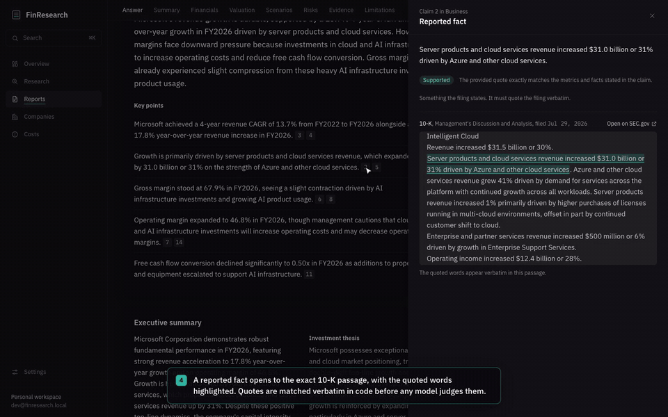
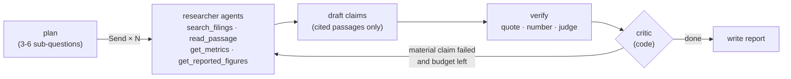

# FinResearch AI

[](https://github.com/asequas/finresearch-ai/actions/workflows/ci.yml)


**An evidence-backed research analyst for US-listed companies.** Ask a question about a ticker. A team of LangGraph
agents researches the company's SEC filings in parallel, code computes every number, a fact-checker verifies every
claim, and the report lets you open any statement to the exact filing passage, figure or formula behind it.



**▶ [Watch the full 2-minute walkthrough](docs/demo/finresearch-demo.mp4)** (MP4, recorded on the real app with real
reports on Microsoft's 10-K; no live model calls during the recording).

## At a glance

| | Result | Evidence |
| --- | --- | --- |
| **Trustworthy output** | Microsoft report: 15 of 16 claims supported, 100% of quotes verbatim in the filing, 100% of numbers match code-computed metrics. NVIDIA: the agent's critic sent a failed claim back and all 16 ended up supported | [`docs/STATUS.md`](docs/STATUS.md), `python -m backend.evals.citations auto <job>` |
| **Better retrieval, measured** | Recall@1 0.567 → **0.733** and MRR 0.706 → **0.811** on a 30-question gold set over real filings, after tuning hybrid search and adding a local cross-encoder | [ADR 0007](docs/adr/0007-retrieval-tuning-and-reranking.md), `python -m backend.evals.retrieval` |
| **Survives failure** | A worker killed with `kill -9` mid-job is recovered by another; the Microsoft run rode out three provider outages by resuming from its Postgres checkpoint without redoing finished work | `tests/integration/test_worker.py`, [ADR 0001](docs/adr/0001-postgres-backed-job-queue.md) |
| **Cheap to run** | **~$0.04–0.11 of model spend per report**, every call priced in a ledger with hard daily and monthly caps; CI/CD on free runners; a ₹0 hosting plan | [ADR 0009](docs/adr/0009-llm-cost-controls-and-ledger.md), [Cost engineering](#cost-engineering) |
| **Tested and shipped like production** | 233 tests on a real Postgres; CI builds x86 and ARM images, boots the whole stack and runs a research job through it before anything is published | [`.github/workflows/ci.yml`](.github/workflows/ci.yml), [ADR 0013](docs/adr/0013-ci-cd-and-single-host-deploy.md) |
| **Decisions written down** | 13 architecture decision records, each with alternatives, failure modes and when to revisit | [`docs/adr/`](docs/adr) |

## Skills demonstrated

| Area | What's in this repo | Where |
| --- | --- | --- |
| Backend and API design | FastAPI + Pydantic; `202 Accepted` + `Location` + `Idempotency-Key` (8 concurrent duplicates → 1 job); cursor pagination; ownership-scoped reads; a strict router → service → repository layering where only services own transactions | [`backend/api`](backend/api), [`backend/services`](backend/services), [ADR 0003](docs/adr/0003-submission-contract-and-idempotency.md) |
| Distributed systems | A durable job queue on Postgres: `FOR UPDATE SKIP LOCKED` claims, leases with heartbeats, fencing tokens against zombie workers, retries with backoff, a reaper, cancellation, resume from the last completed stage | [`backend/worker`](backend/worker), [ADR 0001](docs/adr/0001-postgres-backed-job-queue.md), [ADR 0002](docs/adr/0002-job-state-machine.md) |
| Agentic AI | LangGraph `StateGraph` with `Send` fan-out to parallel tool-using researchers, reducers, a code-routed critic with one bounded revision, a guard that restores the better draft, and a Postgres checkpointer inside the queue's lease | [`backend/agent`](backend/agent), [ADR 0008](docs/adr/0008-langgraph-research-agent.md) |
| RAG and evaluation | Section-aware chunking; `tsvector` + HNSW `vector(768)` hybrid search fused with reciprocal rank fusion; a local MiniLM cross-encoder; a labelled gold set with recall, MRR and nDCG | [`backend/analysis`](backend/analysis), [`backend/evals`](backend/evals), [ADR 0007](docs/adr/0007-retrieval-tuning-and-reranking.md) |
| Hallucination control | Every claim typed as fact, calculation or interpretation; quotes matched verbatim in code, numbers matched against computed metrics, then an LLM fact-check; unsupported claims stay visible and out of the summary | [ADR 0005](docs/adr/0005-evidence-and-provenance-model.md), [ADR 0006](docs/adr/0006-research-pipeline-retrieval-and-llm.md) |
| Data and financial engineering | SEC EDGAR client with fair-access rate limiting and caching; XBRL extraction with provenance (concept, accession, period, filed date); `Decimal` metrics with unit-tested formulas; a cash-flow DCF, earnings power value and reverse DCF with a CAPM cost of capital | [`backend/sources`](backend/sources), [`backend/analysis/metrics.py`](backend/analysis/metrics.py), [`backend/valuation`](backend/valuation), [ADR 0012](docs/adr/0012-fair-value-blend-and-delayed-price.md) |
| Databases | PostgreSQL 17 schema with constraints doing real work (unique idempotency keys, check constraints, cascades); Alembic migrations round-tripped and drift-checked in CI | [`database/migrations`](database/migrations), [ADR 0004](docs/adr/0004-enum-storage.md) |
| Frontend | React 19 + TypeScript, TanStack Query, a client typed from FastAPI's OpenAPI schema (`npm run api:check` fails on drift); live job progress, claim inspector, what-if valuation; keyboard-navigable, responsive, with designed loading, empty, error and partial states | [`frontend/`](frontend), [`frontend/DESIGN.md`](frontend/DESIGN.md) |
| Testing | 233 tests: ten threads racing for one job, a real `kill -9` of a worker, SIGTERM release, the full pipeline against a fake SEC and a scripted tool-calling model; no test can reach a paid API | [`tests/`](tests) |
| DevOps | Multi-stage Docker images, nginx, Compose; a GitHub Actions matrix on native amd64 and arm64 runners; GHCR; an SSH deploy that migrates, smoke-tests and rolls back automatically | [`.github/workflows`](.github/workflows), [`deploy/`](deploy), [ADR 0013](docs/adr/0013-ci-cd-and-single-host-deploy.md) |
| Observability | A trace of every agent and tool call rendered live on the job page; a priced row per model call; stage timings per job | [`backend/costs`](backend/costs), [ADR 0009](docs/adr/0009-llm-cost-controls-and-ledger.md) |

## Why it's production grade

- **No lost or duplicated work.** Submitting a job and enqueueing it is one Postgres transaction, so there's no dual
  write to a broker. Delivery is at-least-once; exactly-once *effects* come from fencing tokens, idempotent stage
  writes and unique constraints. HTTP retries with the same `Idempotency-Key` return the same job.
- **Crashes are routine, not incidents.** Leases expire and another worker takes over; SIGTERM releases a job without
  burning a retry; a retried job resumes at the LangGraph node that failed. All of it is tested with real processes.
- **Correctness before cleverness.** The model never does arithmetic. Deterministic work (fetching filings, parsing
  XBRL, metrics, valuation) is plain tested code; LLMs are used only for planning, research, drafting and judging.
- **Failures are visible.** Missing data, skipped metrics, unsupported claims and the report's limitations are shown,
  not hidden. Financial-sector companies are rejected up front with a reason.
- **Safe delivery.** Every change runs the tests, a migration drift check and a full-stack smoke test on
  both CPU architectures. Deploys migrate before traffic and roll back on a failed health check.
- **Guard rails on spend.** Daily and monthly caps refuse new work with a clear 429 once spent; running jobs stop at a
  resumable point instead of failing.

## Cost engineering

Cost was a design constraint from the start: free or local where quality allows, paid only where it earns its keep,
and every cent measured.

| Decision | Effect |
| --- | --- |
| Deterministic code for everything that doesn't need judgement (ingestion, metrics, valuation, quote and number checks) | Most of the pipeline makes no model calls at all |
| Cheap model for routine steps, a stronger one only for synthesis and judging; fallbacks limited to priced models | Spend goes where reasoning quality matters |
| Old tool results compacted to citable headers before each researcher call | Input per tool call 7.2k → 4.4k tokens; job cost $0.087 → $0.058 |
| A 429 puts that model in cool-down for the provider's suggested delay | Later calls skip it instead of being rejected again |
| Resume from the LangGraph checkpoint after a failure | Finished researchers are never re-run, so retries don't double the bill |
| Local cross-encoder reranker (ONNX, on CPU) | Better retrieval with no per-query API cost |
| On-disk caches: SEC filings (immutable), Treasury yield (daily), delayed quotes (15 min) | Re-runs and re-reads are free |
| A per-call cost ledger at dated list prices, with $1/day and $5/month caps | ~$0.04–0.11 per report, and spend can't run away |
| Tests can't reach the paid API (blocked at the client) | CI and local runs cost nothing |
| Postgres as the queue, vector store and checkpointer | One stateful service instead of Postgres + Redis + a vector DB |
| GitHub Actions and GHCR on a public repo; a single Docker host (Oracle Cloud's free Arm VM fits) | CI/CD and a hosting plan at ₹0 |

## Product tour

| | |
| --- | --- |
|  |  |
| **Overview.** What's running and what's ready; ⌘K searches every company, report and job. | **Live job.** Ten checkpointed stages with typical durations; leave and come back any time. |
|  |  |
| **Research agent.** The plan, every researcher's tool calls, and the fact-checker's decisions. Here it sent a failed claim and an empty-handed question back for another round, and all 16 claims ended up supported. | **Ask the analyst.** Follow-up questions answered by a tool-using agent; each cited quote is checked against the filing. |
|  |  |
| **Report.** The answer first, then summary, financials, scenarios, risks and the evidence ledger. | **Claim inspector.** Every claim opens to the filing passage with the quoted words highlighted. |
|  |  |
| **Company workspace.** Five years of reported figures and every report on the company. | **Phone.** The same report, laid out for a small screen. |
|  |  |
| **Costs.** Every model call priced from its token counts, against daily and monthly caps; by day, model, stage and job. | **Valuation.** Fair value from a cash-flow DCF and earnings power, every assumption sourced; the delayed price is placed against the range, with the growth it implies. |

## Architecture


Ingestion is deterministic code; the research itself is a LangGraph agent graph (ADR 0008), checkpointed in Postgres
so a retried job resumes at the node that failed:



Each stage writes its outputs idempotently, every node is lease-fenced, and the job page shows each researcher's
tool calls live.

| Stage | Kind | Output |
| --- | --- | --- |
| Resolve company | deterministic | SEC CIK, industry (financial-sector companies are rejected in v1) |
| Fetch filings | deterministic | latest 10-K and any newer 10-Q |
| Extract financials | deterministic | five fiscal years from XBRL, latest filing wins on restatement |
| Compute metrics | deterministic | margins, FCF, growth, ROE, leverage, CAGR, each with formula and inputs |
| Fair value | deterministic | cash-flow DCF + earnings power value; industry beta, Treasury 10-year, Damodaran ERP; range, sensitivity |
| Index filings | deterministic + embeddings | section-aware chunks, `tsvector` + HNSW `vector(768)` |
| Plan | LLM | 3-6 sub-questions, each with a focus |
| Research | parallel tool-using agents | each researcher searches (tuned hybrid + local cross-encoder rerank), reads passages and pulls metrics, within a call budget |
| Draft | LLM | claims citing only passages the researchers read, plus verifier feedback on a revision |
| Verify | code first, then LLM; code-routed revision | quote check, numeric check, fact-check verdicts; material failures go back to a researcher once |
| Synthesize | LLM | answer, summary, bull/base/bear with anchored assumptions, risks, limitations |

Design decisions, alternatives and failure modes are written up as ADRs in [`docs/adr/`](docs/adr):
[durable queue on Postgres](docs/adr/0001-postgres-backed-job-queue.md) ·
[job state machine](docs/adr/0002-job-state-machine.md) ·
[202 + idempotency keys](docs/adr/0003-submission-contract-and-idempotency.md) ·
[enum storage](docs/adr/0004-enum-storage.md) ·
[evidence and provenance model](docs/adr/0005-evidence-and-provenance-model.md) ·
[pipeline, retrieval and LLM use](docs/adr/0006-research-pipeline-retrieval-and-llm.md) ·
[retrieval tuning and reranking](docs/adr/0007-retrieval-tuning-and-reranking.md) ·
[LangGraph research agent](docs/adr/0008-langgraph-research-agent.md) ·
[LLM cost controls and ledger](docs/adr/0009-llm-cost-controls-and-ledger.md) ·
[DCF intrinsic value](docs/adr/0010-dcf-intrinsic-value.md) ·
[valuation v2: R&D, advantage, price check](docs/adr/0011-valuation-v2-rd-advantage-price-check.md) ·
[fair-value blend and delayed price](docs/adr/0012-fair-value-blend-and-delayed-price.md) ·
[CI/CD and single-host deploy](docs/adr/0013-ci-cd-and-single-host-deploy.md).

Retrieval quality on a 30-question gold set over real filings (ADR 0007):

| | Recall@1 | Recall@3 | MRR@10 | nDCG@6 |
| --- | --- | --- | --- | --- |
| Hybrid search as first built | 0.567 | 0.800 | 0.706 | 0.528 |
| Tuned hybrid + cross-encoder rerank | **0.733** | **0.900** | **0.811** | **0.626** |

## Run it locally

Requirements: Python 3.12, Node 22+, Docker.

Once set up (below), one command starts the database, migrations, API, a worker and the UI, and explains anything
that's missing:

```bash
scripts/dev.sh        # UI on http://localhost:5173
```

First-time setup:

```bash
# 1. Database
docker compose up -d                                   # Postgres 17 + pgvector

# 2. Backend
python3.12 -m venv .venv && source .venv/bin/activate
pip install -r requirements.txt && pip install -e .
cp .env.example .env                                   # then fill in the values below
alembic upgrade head
uvicorn backend.main:app --reload                      # API on :8000, docs at /docs

# 3. Worker (one or more, in other terminals)
python -m backend.worker.main

# 4. Frontend
cd frontend && npm install && npm run dev              # UI on :5173
```

`.env`:

```bash
DATABASE_URL=postgresql+psycopg://finresearch:<password>@localhost:5432/finresearch
GEMINI_API_KEY=<free key from https://aistudio.google.com/apikey>
SEC_USER_AGENT=FinResearch AI <your contact email>       # SEC EDGAR requires a contact address
# PIPELINE=stub                                          # run the queue with fake stages, no external calls
```

## Deploy

CI builds the production images for x86 and ARM, boots the full stack from them, and runs a research job through
nginx before anything ships. On `main` the tested images go to GHCR, and the Deploy workflow ships them to one
server over SSH: migrate, restart, smoke test, automatic rollback ([ADR 0013](docs/adr/0013-ci-cd-and-single-host-deploy.md)).

On the server (any Docker host; Oracle Cloud's free Arm VM is enough):

```bash
mkdir ~/finresearch && cd ~/finresearch
# copy deploy/.env.example to .env and fill it in (POSTGRES_PASSWORD, GEMINI_API_KEY, SEC_USER_AGENT)
```

In GitHub, create the `production` environment with secrets `DEPLOY_HOST`, `DEPLOY_USER` and `DEPLOY_SSH_KEY`, then
set the repository variable `DEPLOY_ENABLED=true`. The next green `main` deploys; run the Deploy workflow by hand
with an older `sha-…` tag to roll back.

## Tests

```bash
docker exec finresearch-postgres psql -U finresearch -c "CREATE DATABASE finresearch_test"   # once
python -m pytest                       # isolated *_test database, truncated after every test
cd frontend && npm run typecheck && npm run api:check
```

The suite covers the queue's concurrency guarantees (ten threads racing for one job, zombie-worker fencing, a real
`kill -9` of a worker process mid-job, graceful SIGTERM), the API contract, schema constraints, every metric formula,
XBRL extraction, filing parsing, and the full pipeline end to end with a fake SEC transport, a fake LLM and a
scripted tool-calling model: the agent's fan-out, its bounded revision loop, resume after a 429 without re-running
finished researchers, cancel mid-research, the trace API and the analyst chat's citation checks.

## Evaluation

```bash
python -m backend.evals.retrieval                          # retrieval quality: vector vs keyword vs hybrid vs reranked
python -m backend.evals.citations auto <job_id>            # coverage, quote verification, numeric consistency
python -m backend.evals.citations export <job_id> > evals/labels/MSFT.json
python -m backend.evals.citations score evals/labels/*.json # human-labelled citation correctness vs the 95% target
```

## Project layout

```text
backend/
  api/            routes, dependencies (dev identity until auth lands)
  services/       transactions live here: job submission, queue operations, reports
  repositories/   SQL, including the fenced queue updates (never commit)
  agent/          LangGraph research graph, researcher tools, Postgres checkpointer
  pipeline/       stage runner, ingestion stages, prompts and output schemas
  sources/        SEC EDGAR client, XBRL extraction, filing text parsing
  analysis/       metrics (Decimal), chunking, hybrid retrieval, verification
  llm/            provider adapter (Gemini): retry classification, model cool-downs, pacing
  costs/          cost ledger, dated price table, spend caps
  valuation/      fair-value engine, default assumptions, reference data, Treasury rate, delayed quote, backfill
  worker/         the worker process: claim, heartbeat, retry, release
  evals/          evidence-quality metrics and label scoring
database/migrations/   Alembic revisions (never edit an applied one)
frontend/              React app; design system in frontend/DESIGN.md
docs/                  STATUS.md, ADRs, INTERVIEW_NOTES.md
```

## Scope (v1)

US-listed, non-financial companies that file a 10-K, in USD. Prices come from Cboe's free delayed quote, which is
licensed for personal, non-commercial use (a commercial deployment needs a licensed feed), or from a price the reader
types; the written report makes no price claims, and there are no valuation multiples or price targets. Single development user until authentication (planned with deployment).
